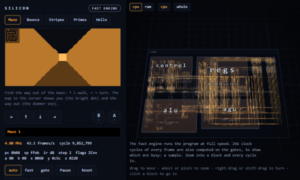
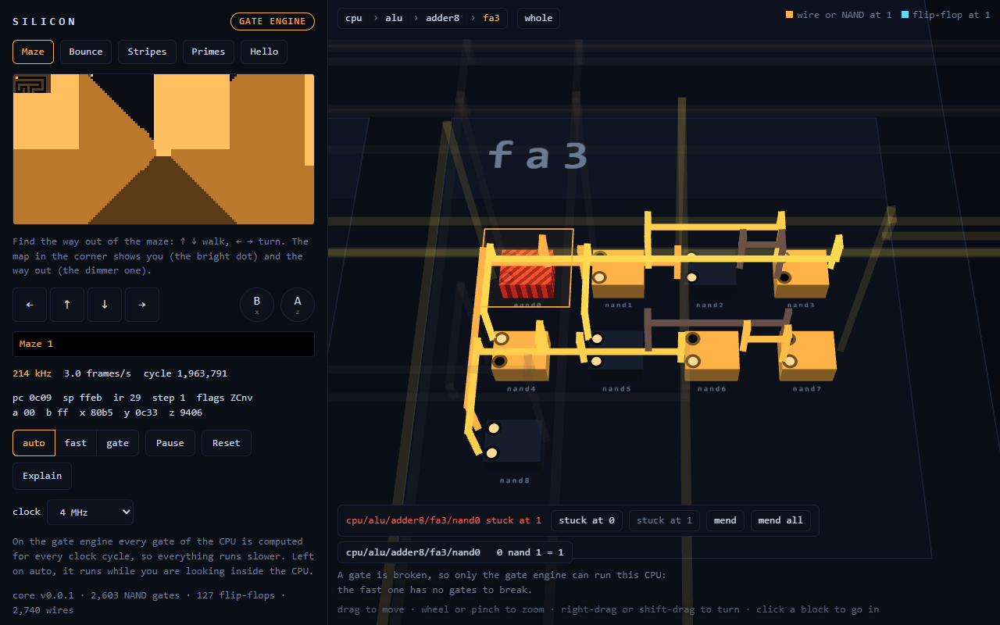
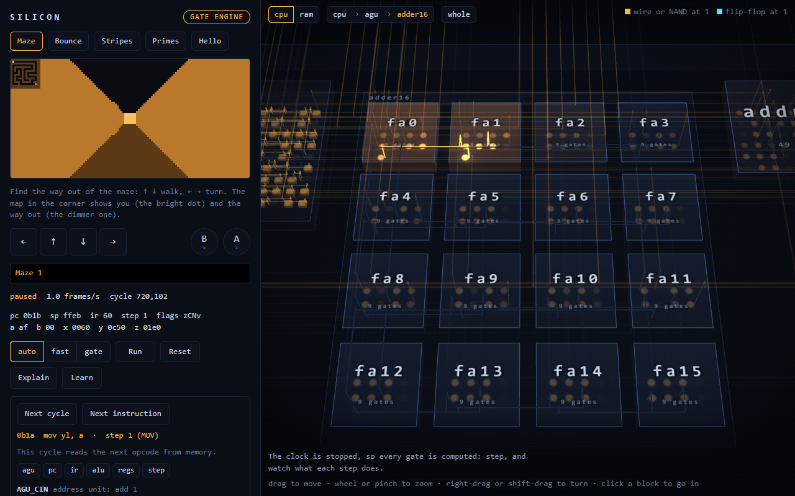
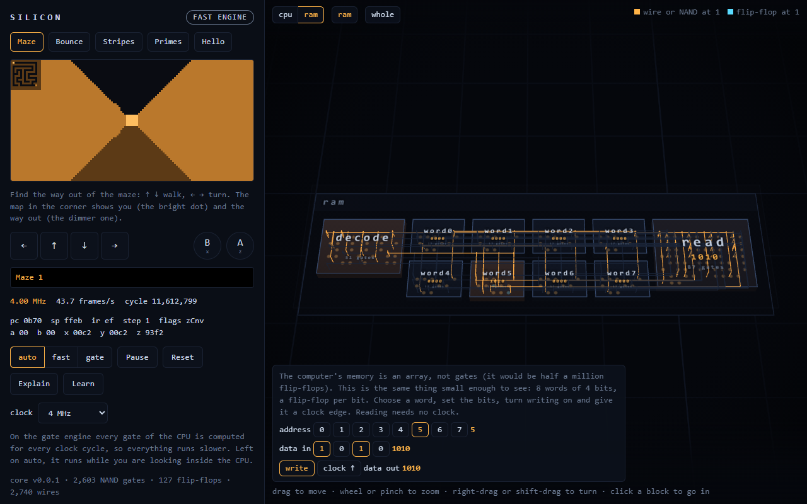
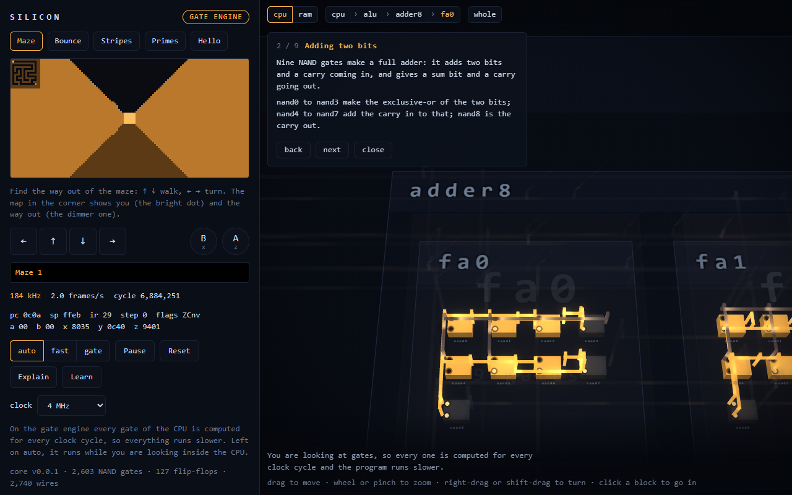

# Silicon

**A 3D game running on a CPU you can zoom into, down to every single NAND gate.**

**[Try it in your browser →](https://paulopnun.github.io/silicon/)** Nothing to install: arrow keys to play, scroll to fly into the CPU.



Silicon is an 8-bit computer designed from scratch out of nothing but **2,603
NAND gates and 127 flip-flops**, simulated gate by gate in your browser and
drawn in 3D. It runs a first-person maze game, written for it in a C-like
language, compiled by its own compiler, while you fly down into the hardware
and watch the wires that compute each frame switch.

Nothing on screen is an animation of the computer. Every lit wire is a wire
of the simulated netlist; every explanation is read from the control unit's
own microcode; when you break a gate, the game you are playing breaks.

## What you can do

- **Fly into the hardware.** From the whole CPU down to the pins of a single
  gate, blocks open as you approach and close as you leave, with no level
  switches and no popping. Every wire is drawn, routed at the height of the
  module it belongs to. A busy wire glows and carries pulses that move the
  way its signal goes, away from the gate that drives it; a closed block
  lets the lights of its gates through, like a city at night.
- **Play the game on the gates.** At a distance the program runs on a fast
  model of the CPU at 4 MHz; as soon as gates are in sight the page hands the
  CPU over to the gate-level engine, mid-instruction, and every NAND is
  computed for every clock cycle. The two engines are proven equivalent,
  cycle by cycle.
- **Follow one instruction.** *Explain* pauses the machine and shows, for each
  clock cycle, the instruction, its microcode step, what it does with
  memory, the blocks it sets to work, and every control signal with its
  meaning. Each step is played back in the scene in the order the logic
  settles: you watch a carry ripple through the adder, gate by gate.
- **Break a gate.** Click any gate and stick its output at 0 or 1, as chip
  testers do. One stuck NAND in the ALU's adder is enough to wreck the maze.
- **See how memory works.** The computer's 64 KiB are an array, but a small
  memory of 8 × 4 bits is built from gates beside it, to write and read by
  hand.
- **Take the tour.** Nine steps from one NAND gate to a running program; the
  camera flies to each part as it is explained.

| One stuck gate | One clock cycle, played back |
|---|---|
|  |  |

| Memory made of gates | The guided tour |
|---|---|
|  |  |

## How it is built

```
programs/*.c, *.asm ──cc──► assembly ──asm──► ROM        (crates/cc, crates/asm)
                                               │
┌──────────────────────────────────────────────▼──────────────────────┐
│ machine: memory map, screen, keys, timer, console     (crates/machine)│
│   CPU behind one trait, two interchangeable engines:                  │
│     gate: the NAND/DFF netlist, levelized       (crates/sim-gate)     │
│     fast: an arithmetic model of the same ISA   (crates/sim-fast)     │
└──────────────────────────────┬──────────────────────────────────────┘
                               │ WebAssembly, in a Web Worker  (crates/wasm)
                      ┌────────▼────────┐  wire levels,  ┌───────────────────┐
                      │ simulation      │──activity,────►│ Three.js scene,   │
                      │ worker          │  registers     │ ten draw calls    │
                      └─────────────────┘                └───────────────────┘
```

- **The hardware** is written in a small Rust DSL (`crates/hdl`) with exactly
  two primitives, `nand` and `dff`. The control unit is a microcode table
  compiled to a PLA of gates. Every block is tested against a plain Rust
  reference, exhaustively where the input space allows.
- **Two engines, proven equivalent.** A lockstep harness runs both on the
  same program and compares the full architectural state and every bus
  access each cycle: millions of cycles of random programs and every real
  program, in CI. A structural test asserts that every flip-flop maps to a
  bit of the architectural state, so the CPU can move between engines at
  any cycle without losing anything.
- **The toolchain runs in the browser.** Programs travel as source and are
  compiled and assembled inside the WebAssembly core when you pick them. The
  compiler is checked against a reference on 1,500 random programs every
  run, and its multiplication, division and shifts on every pair of bytes.
- **The scene is computed, not modelled.** Layout, wire routing, levels of
  detail, picking and camera flights are pure functions of the netlist and
  the camera, tested without a browser; the renderer only draws them.

### A few things worth reading

- **Activity counted for free** (`crates/sim-gate`): each wire's level and
  the count of its changes share one 32-bit word. A change adds one, which
  flips bit 0, so bit 0 stays the level. Counting costs one load per gate
  instead of a second array.
- **Faults at no cost** (`GateSim::force`): a NAND stuck at 1 is rewired to
  read the constant 0 twice; one stuck at 0, the constant 1. The inner loop
  never changes.
- **From the whole CPU to one pin in 32-bit floats** (`web/src/scene/view.ts`):
  every position is a whole number plus a small rest, and so is the eye; the
  shader subtracts whole from whole and rest from rest, so precision is
  finest where the camera is.
- **Smooth flights** (`web/src/scene/camera.ts`): the camera pulls back to
  travel and closes in to arrive, along the optimal zoom-and-pan path of
  van Wijk and Nuij.
- **The screen is never caught half drawn** (ADR 0013): there is no page
  flip, so programs draw in place, and the tests sample the screen between
  frames, not only at their ends.

## Numbers

| | |
|---|---|
| CPU | 2,603 NAND gates, 127 flip-flops, critical path 67 gates |
| Instruction set | 8-bit data, 16-bit addresses, 256 opcodes, none illegal |
| Fast engine in WebAssembly | ~300 M cycles/s |
| Gate engine in WebAssembly | ~205 k cycles/s, counting every wire's changes |
| The maze game | 45 frames/s at the nominal 4 MHz; 2–3 frames/s on the gates |
| The game's ROM | 4.8 KiB of 32 |
| A picture of the scene | 0.2 ms of main-thread time; 2.7 ms of the graphics card's with the glow (RTX 5060 Ti, 1280×800) |
| Loading the page | 326 KiB over the wire; Lighthouse performance 93 on a throttled phone, 100 on a desktop |
| Tests | 297 in Rust, 154 in Vitest, 19 checks of the built page in a real Chrome |

## Run it

Requirements: Rust (stable, with the `wasm32-unknown-unknown` target),
`wasm-pack`, Node 22+, pnpm.

```sh
pnpm install
pnpm dev                 # builds the WebAssembly core, starts the dev server
```

Then pick a program, use the arrow keys, and scroll into the CPU. Links can
say where to look: `?at=cpu/alu/adder8/fa3`, `?program=bounce&engine=gate`,
`?view=ram`. The glow turns itself off on a graphics card that finds it
heavy; `?glow=off` and `?glow=on` settle it by hand.

```sh
cargo test --workspace   # the hardware, both engines, the toolchain, the programs
pnpm test                # the scene, the page's logic, against the real netlist
pnpm build && pnpm check # the built page, driven in Chrome
pnpm bench               # both engines' speed in WebAssembly
```

To see what the compiler makes of a program:

```sh
cargo run -p silicon-cc --example cc -- programs bounce.c
```

## Documentation

- [ARCHITECTURE.md](docs/ARCHITECTURE.md): the design, subsystem by subsystem.
- [ISA.md](docs/ISA.md): the instruction set, with the opcode table.
- [LANGUAGE.md](docs/LANGUAGE.md): the C-like language of the programs.
- [adr/](docs/adr): every decision that had a real alternative, and why.
- [PROGRESS.md](docs/PROGRESS.md): what is done, how it was verified, and what is not.

## License

MIT
