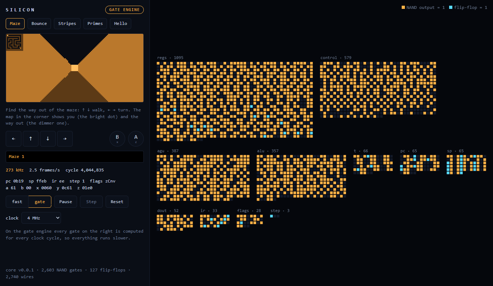

# Silicon

**A 3D game running on a CPU you can zoom into, in 3D, down to every single NAND gate.**



> Work in progress. The computer exists and runs in the browser: a CPU of
> 2,603 NAND gates and 127 flip-flops, checked cycle by cycle against a
> reference model, running a maze game written for it while you watch every
> gate. The 3D view of the hardware does not exist yet. See
> [docs/PROGRESS.md](docs/PROGRESS.md) for status,
> [docs/ISA.md](docs/ISA.md) for the instruction set,
> [docs/LANGUAGE.md](docs/LANGUAGE.md) for the language its programs are
> written in and [docs/ARCHITECTURE.md](docs/ARCHITECTURE.md) for the design.

Silicon is a complete 8-bit computer designed from scratch out of NAND gates and
D flip-flops, simulated at gate level, and rendered in real-time 3D in the
browser.

## Build it locally

Requirements: Rust (stable, with the `wasm32-unknown-unknown` target),
`wasm-pack`, Node 20+, pnpm.

```sh
pnpm install
pnpm dev          # builds the WASM core, then starts the dev server
cargo test --workspace
pnpm test
pnpm bench        # speed of both engines in WebAssembly
```

The programs are in [`programs/`](programs), in assembly and in a small
C-like language; the toolchain that builds them is part of the project and
runs in the browser too. To see what the compiler makes of one:

```sh
cargo run -p silicon-cc --example cc -- programs bounce.c
```

## License

MIT
